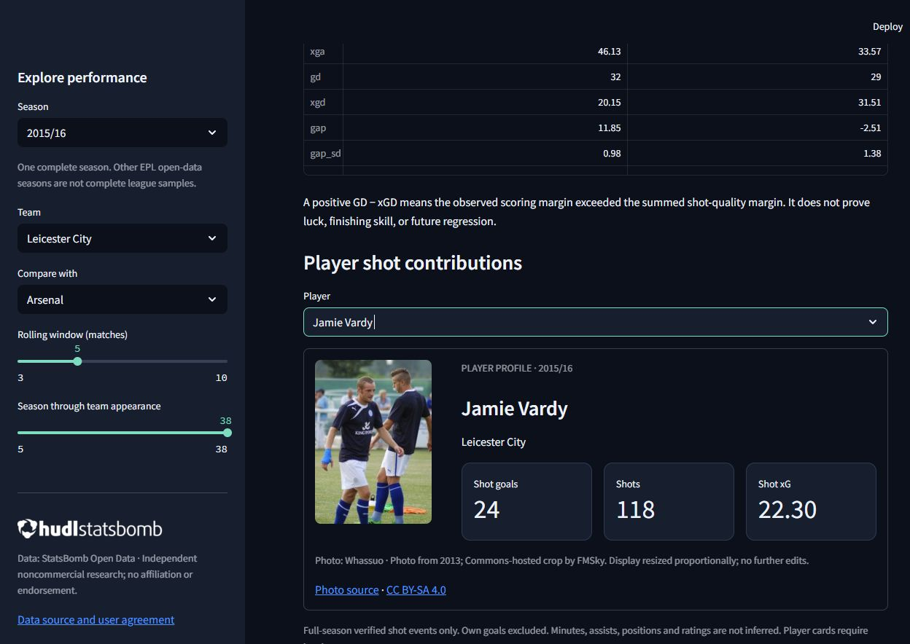

# Premier League Performance Intelligence


A JuvoLab research project distinguishing Premier League results from underlying shot quality through a reproducible Python, SQLite and Streamlit workflow.

**[Open the live JuvoLab dashboard](https://juvolab-premier-league.streamlit.app/)**

Research question: How closely do attacking and defensive chance-quality indicators align with team results, and how does the gap change during a season?

## Scope

StatsBomb Open Data, Premier League 2015/16: 380 matches, 20 clubs, 38 appearances per club. One provider and one complete season. This is descriptive research, not betting advice, prediction or causal inference. Multi-season persistence cannot be established.

## Reproduce

Use Python 3.12. From this directory:

```powershell
python -m venv .venv
.venv/Scripts/python -m pip install -r requirements.txt
.venv/Scripts/python ingest.py
.venv/Scripts/python analysis.py
.venv/Scripts/python -m pytest -q -p no:cacheprovider
.venv/Scripts/python -m streamlit run app.py
```

The pipeline retrieves files directly from the public repository. No scraping or credentials are required. Network access is needed on the first run; subsequent runs use the local cache. Source commit: `4b73468fc5b0f1950f9f66fada70ad3a4f9327cb`. For the tested Windows/Python 3.12 environment, install `requirements-lock-windows-py312.txt` instead of requirements.txt. The lock captures all transitive packages; Linux CI also passes. Initial event downloads total approximately 1.13 GB. Do not enable inherited system packages.

For an independent fresh-data run, set `$env:PLPI_DATA_DIR = Join-Path (Get-Location) 'data/fresh-run'` before running ingestion, analysis and tests in the same terminal. All application data locations honor that setting. Unset it afterward with `Remove-Item Env:PLPI_DATA_DIR` to return to the default data location.

## Structure

| Component | Purpose |
|---|---|
| `verify_source.py` | Profile the originally proposed CSV |
| `ingest.py` | Retrieve and validate event data; construct relational SQLite database |
| `queries/team_matches.sql` | Join match, team and season records with a bound season parameter |
| `analysis.py` | Team aggregates, rolling means, cumulative gaps, bootstrap interval |
| `player_cards.py` | Verified shot contributions; no inferred minutes, positions or ratings |
| `app.py` | Interactive team profiles, charts and comparison views |
| `tests/` | Integrity, known totals, missing-xG and temporal checks |
| `docs/` | Source decision, technical case study and validation record |

## Findings

Points and team-season xG difference correlate at r = 0.899 (20 teams). West Ham has the largest positive goal-difference residual (+13.74); Aston Villa the largest negative (−18.99). These describe observed scoring margins relative to summed shot xG; they do not isolate luck or repeatable skill. See the case study for temporal comparisons and limitations.

## Data rights

Data source: **StatsBomb Open Data**. [Source](https://github.com/statsbomb/open-data), [user agreement](https://github.com/statsbomb/open-data/blob/master/LICENSE.pdf). Research outputs may be shared with attribution and the official logo; commercial exploitation and redistribution of underlying data are restricted. Raw events, audit downloads, SQLite databases and generated data tables are ignored by Git. Code licensing does not grant rights to StatsBomb data.

The official externally approved logo is included and displayed with source credit. See [attribution and output review](docs/attribution-and-release.md). Do not expose raw-event downloads. Streamlit Community Cloud is the recommended hosting target, subject to approval and a deployment data-build plan.

## Current verification and outstanding work

Seven automated tests pass, including relational SQL/Pandas agreement, dashboard filter interactions, and first-run/cached initialization. Fresh source retrieval reproduces all 381 file hashes and identical database rows. All 380 matches reconcile event goals with scorelines, including own goals. Linux GitHub Actions also validates the full pipeline. Desktop/mobile rendering and selected keyboard interactions have been checked; full accessibility certification and every browser/device combination have not been established.

On a fresh host, the dashboard automatically builds private runtime data from the pinned source. The initial setup may take a few minutes; later visits reuse the database and player summaries. Provider data remain outside source control.

Created by JuvoLab. See the technical case study for methods, findings and analytical limitations.

## Player profiles

Interactive player cards show verified full-season shots, shot goals and shot xG. Jamie Vardy and Harry Kane also have licensed photographs; other players retain statistical cards without invented imagery. [Photo attribution and licenses](assets/players/README.md). Photos are illustrative and may have been taken outside the analysed season. No player ratings, minutes or assists are inferred.


